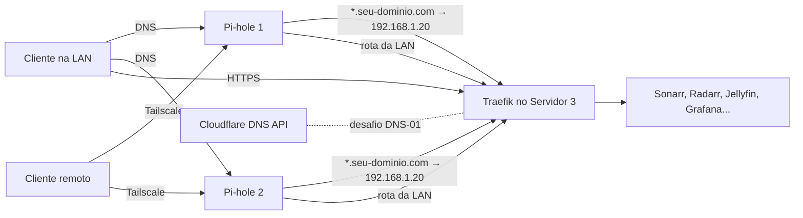

# 🚀 Infraestrutura Homelab com Docker Compose

Documentação e arquivos de implantação (Docker Compose) para um homelab distribuído em três servidores físicos: dois nós de DNS/acesso remoto e um servidor central de mídia, automação, proxy e monitoramento.

> **Revisado em 13/10/2026.** Versões, nomes de variáveis e imagens foram conferidos contra a documentação upstream nessa data, e **todas as imagens estão com versão fixa** (seção 9). Os pontos que **não** foi possível validar estão listados na seção [10](#-10-pontos-em-aberto-e-a-verificar).

---

## 📑 Índice

1. [Arquitetura](#-1-arquitetura-e-distribuição-dos-servidores)
2. [Decisões de design](#-2-decisões-de-design)
3. [Pré-requisitos](#-3-pré-requisitos)
4. [Estrutura de diretórios](#-4-estrutura-de-diretórios)
5. [Arquivos de configuração](#-5-arquivos-de-configuração)
6. [Inicialização (ordem correta)](#-6-inicialização-ordem-correta)
7. [Checklist pós-instalação](#-7-checklist-pós-instalação)
8. [Backup](#-8-backup)
9. [Atualizações e manutenção](#-9-atualizações-e-manutenção)
10. [Pontos em aberto e a verificar](#-10-pontos-em-aberto-e-a-verificar)
11. [Solução de problemas](#-11-solução-de-problemas)
12. [Validação automática (CI)](#-12-validação-automática-ci)

---

## 📐 1. Arquitetura e Distribuição dos Servidores

| Servidor | Hardware | IP (sugerido) | Papel |
|---|---|---|---|
| **1** | NanoPi NEO (armv7l, 512 MB) | `192.168.1.10` | DNS primário + Tailscale (subnet router) |
| **2** | Raspberry Pi 3 (ver nota) | `192.168.1.11` | DNS secundário + Tailscale (subnet router, redundância) |
| **3** | Orange Pi 5 Plus (RK3588, 16 GB) | `192.168.1.20` | Mídia, automação, proxy reverso, gestão e monitoramento |

> ⚠️ **Nota sobre o Servidor 2:** o Raspberry Pi 3 Model B/B+ tem **1 GB** de RAM; só o 3 A+ tem 512 MB. Confirme o modelo — isso muda o quanto de folga existe para os containers.
>
> Use **IP fixo ou reserva DHCP** nos três servidores. Todo o DNS e o certificado dependem disso.

### Serviços por servidor

- **Servidores 1 e 2:** `Pi-hole` + `Unbound` (um container) e `Tailscale`.
- **Servidor 3:**
  - **Mídia e automação:** `qBittorrent`, `Flaresolverr`, `Prowlarr`, `Sonarr`, `Radarr`, `Lidarr`, `Bazarr`, `Unpackerr`, `Recyclarr`, `Jellyfin`, `Seerr`, `Navidrome`.
  - **Infraestrutura:** `Traefik v3`, `socket-proxy` (×2), `Portainer`, `Homepage`, `nebula-sync` (replica o Pi-hole 1 no 2).
  - **Monitoramento:** `Prometheus`, `Grafana`, `node-exporter`.

### Como as peças se conectam



1. **DNS:** o roteador entrega os dois Pi-holes como DNS. Ambos respondem `*.seu-dominio.com` com o IP do Servidor 3 (registro local — sem isso, os hostnames não resolvem dentro da LAN).
2. **TLS:** o Traefik obtém um certificado **wildcard** válido via desafio DNS-01 da Cloudflare. Nenhuma porta é aberta no roteador.
3. **Acesso remoto:** os dois Pi-holes anunciam a sub-rede da LAN no Tailscale (alta disponibilidade). Fora de casa, o celular/notebook alcança a LAN inteira — inclusive o Traefik — e usa os Pi-holes como DNS.

### Mapa de portas (Servidor 3)

| Porta | Serviço | Exposição |
|---|---|---|
| 80 / 443 | Traefik | LAN |
| 6881 tcp/udp | qBittorrent (peers) | LAN/roteador, conforme sua política |
| demais UIs | via Traefik (`servico.seu-dominio.com`) | LAN / Tailscale |

---

## 🔍 2. Decisões de Design

### A. Gerenciamento de containers: Portainer vs. Dockhand/Hawser
* **Portainer Server (+ Agent):** padrão de mercado, interface completa. Consumo de RAM aproximado: ~100–180 MB (Server), ~30–50 MB (Agent).
* **Dockhand + Hawser:** alternativa mais leve, voltada a homelabs.
* **Decisão:** Portainer no Servidor 3. Para gerenciar os Servidores 1 e 2 a partir dele, há um `portainer-agent` opcional no compose de DNS (`--profile agent`). Em 512 MB, avalie se vale o custo; o `Hawser` é a alternativa mais leve.
* *Os números de RAM são estimativas — meça com `docker stats` no seu hardware.*

### B. Streaming de áudio: Navidrome + Jellyfin
* **Jellyfin:** filmes, séries e vídeos. No RK3588 a aceleração usa **Rockchip MPP/RGA (RKMPP)**, não só `/dev/dri` — veja a seção 5.4.
* **Navidrome:** leve, focado em música, com API Subsonic (Symfonium, Finamp, Feishin).
* **Decisão:** manter os dois.

### C. Proxy reverso e TLS: Traefik + Cloudflare DNS-01
* **Traefik v3.6.1 ou superior** (fixado em `v3.7.x`). Versões anteriores usam um cliente da API do Docker antigo e **deixam de enxergar os containers com Docker Engine 29+** (erro `client version 1.24 is too old`).
* **Certificado wildcard** (`*.seu-dominio.com`) em vez de um certificado por subdomínio: evita emitir um certificado a cada serviço novo e **não publica seus hostnames internos nos logs públicos de Certificate Transparency**.
* **Resolvers públicos para o desafio DNS-01** (`1.1.1.1`, `1.0.0.1`): como o Pi-hole responde `*.seu-dominio.com` localmente, usar o DNS da LAN para validar o `_acme-challenge` faria a verificação de propagação falhar.
* **Token da Cloudflare** com escopo mínimo: `Zone:Zone:Read` + `Zone:DNS:Edit`, restrito à zona do domínio.

### D. Mídia e automação
* **Layout de pastas unificado (`/data`)** — mudança mais importante em relação à versão anterior. Sonarr/Radarr/Lidarr/qBittorrent/Unpackerr enxergam **um único ponto de montagem** (`/data`), contendo `torrents/` e `media/` no mesmo filesystem. Assim as importações viram *hardlinks* instantâneos (sem copiar nem duplicar espaço enquanto o torrent continua semeando) e todos os apps veem os mesmos caminhos (o Bazarr depende disso). Padrão recomendado pelos TRaSH Guides.
* **Unpackerr:** extrai `.rar`/`.zip` baixados pelo qBittorrent para importação pelo Sonarr/Radarr.
* **Recyclarr:** sincroniza perfis de qualidade e custom formats do TRaSH Guides. Os perfis são referenciados por `trash_id` e trazem seus custom formats junto, em vez de uma lista manual de IDs.
* **Seerr** substitui o Jellyseerr: os projetos Overseerr e Jellyseerr foram unificados no **Seerr** (imagem `ghcr.io/seerr-team/seerr`); a migração dos dados é automática no primeiro boot.
* **Versões fixas + Dependabot (sem Watchtower):** todas as imagens usam tag explícita. O Watchtower atualiza re-baixando a *mesma* tag, então com versões fixas ele não faria nada (e exigia `docker.sock` com escrita), por isso foi removido. Quem propõe as atualizações é o **Dependabot**, como PR; o CI valida o PR (`compose config`, testes e existência da imagem para `arm64`/`arm/v7`) e, ao mesclar, você aplica com `scripts/update.sh`. Detalhes na seção 9.
* **Recyclarr:** desde a 8.4.0 não existe mais a tag `latest`; a versão fixa é obrigatória. O `trash_id` em perfis de qualidade também só existe a partir da 8.0.

### E. Estratégia de backup
Backup de imagem do SO é ineficiente para containers. O que importa é `CONFIG_DIR`, os `.env` e os arquivos Compose, com backup incremental, criptografado e deduplicado via **Restic**. A seção 8 traz um script pronto, com política de retenção e o lembrete de **testar a restauração**.

### F. Pi-hole: imagem e variáveis
* A imagem anterior (`cbcrowe/pihole-unbound`) está **parada há mais de 2 anos** e baseada no Pi-hole 2024.03 (v5). Substituída por `mpgirro/pihole-unbound`, mantida e baseada no Pi-hole v6 (multi-arch, inclui `arm/v7` do NanoPi).
* O Pi-hole v6 **removeu quase todas as variáveis antigas**. `WEBPASSWORD`, `FTLCONF_LOCAL_IPV4` e `REV_SERVER*` não funcionam mais; usam-se `FTLCONF_webserver_api_password`, `FTLCONF_dns_revServers`, etc.

---

## 🧰 3. Pré-requisitos

- **Docker Engine + Compose v2 recentes** em todos os servidores. A chave `version:` dos arquivos Compose é obsoleta e foi removida.
- **Servidor 3:** instalar o SO com **kernel BSP Rockchip (5.10 ou 6.1)**. O Jellyfin só suporta RKMPP nesses kernels (não no mainline). Prefira **NVMe** para `CONFIG_DIR` e para a raiz do Docker: SQLite do Sonarr/Radarr, Prometheus e Jellyfin escrevem muito e desgastam cartão SD.
- **Servidores 1 e 2:** cartão SD de qualidade, `zram`/swap ativos e, se possível, `log2ram`. Em Ubuntu/Armbian, libere a porta 53: desative o stub do `systemd-resolved` (`DNSStubListener=no` em `/etc/systemd/resolved.conf`).
- **Rotação de logs do Docker** (`/etc/docker/daemon.json`), principalmente nas placas com SD:
  ```json
  { "log-driver": "local", "log-opts": { "max-size": "10m", "max-file": "3" } }
  ```
- **Tailscale (Servidores 1 e 2):** habilitar o encaminhamento de pacotes no host:
  ```bash
  echo 'net.ipv4.ip_forward=1' | sudo tee /etc/sysctl.d/99-tailscale.conf
  sudo sysctl --system
  ```
- **Domínio na Cloudflare** com token de API criado conforme a seção 2.C.
- **Roteador:** DHCP entregando `192.168.1.10` e `192.168.1.11` como DNS.

---

## 📁 4. Estrutura de Diretórios

```text
docker-infra/
├── .github/
│   ├── workflows/validate.yml # CI: lint, compose config, pytest, README, gitleaks
│   ├── workflows/images.yml   # semanal: imagens existem p/ arm64/armv7?
│   └── dependabot.yml
├── .env                       # Servidor 3 (NÃO versionar) — copie de .env.example
├── .env.example
├── .gitignore
├── .yamllint.yml
├── Makefile                   # make check = o que o CI roda
├── README.md
├── docs/daemon.json           # rotação de logs do Docker
├── recyclarr/
│   └── recyclarr.yml
├── scripts/
│   ├── setup.sh               # symlinks do .env, pastas, permissões, proxy-net
│   ├── backup.sh              # backup com Restic
│   ├── validate_compose.sh    # docker compose config + testes de guardas
│   ├── sync_readme.py         # README <-> arquivos
│   └── check_images.py        # imagens/arquiteturas no registry
├── tests/                     # pytest (convenções da infraestrutura)
├── stack-dns/                 # Servidores 1 e 2 (cada nó tem o SEU .env)
│   ├── .env                   # NÃO versionar
│   ├── .env.example
│   └── docker-compose.yml
├── stack-management/          # Servidor 3
│   ├── .env -> ../.env        # symlink (criado pelo setup.sh)
│   └── docker-compose.yml
├── stack-media/               # Servidor 3
│   ├── .env -> ../.env
│   └── docker-compose.yml
└── stack-monitoring/          # Servidor 3
    ├── .env -> ../.env
    ├── docker-compose.yml
    └── prometheus/
        └── prometheus.yml
```

> **Por que os symlinks?** O Compose lê o `.env` do diretório do projeto (a pasta do `docker-compose.yml`), **não** o da pasta pai. Sem eles, todas as `${VARIAVEIS}` ficam vazias. Crie-os uma vez:
> ```bash
> cd docker-infra
> for s in stack-management stack-media stack-monitoring; do ln -s ../.env $s/.env; done
> ```
> Ou simplesmente rode `./scripts/setup.sh`, que também cria as pastas e a rede (seção 6.1).
>
> **Por que `.env` separados?** Os Pis de DNS não precisam do token da Cloudflare nem das chaves de API do Sonarr/Radarr. Menos segredos em hardware com cartão SD, menor estrago se um nó for comprometido.

### `.gitignore`

<!-- file: .gitignore -->
```gitignore
.env
**/.env
__pycache__/
*.pyc
.pytest_cache/
```

---

## ⚙️ 5. Arquivos de Configuração

### 📄 5.1. Variáveis do Servidor 3 (`.env.example` → `.env`)

<!-- file: .env.example -->
```env
# ==========================================
# GERAL
# ==========================================
TZ=America/Sao_Paulo
PUID=1000
PGID=1000

# ==========================================
# DOMÍNIO E CERTIFICADOS (TRAEFIK + CLOUDFLARE)
# ==========================================
MY_DOMAIN=seu-dominio.com
ACME_EMAIL=seu-email@exemplo.com
# Escopo mínimo: Zone:Zone:Read + Zone:DNS:Edit, só na zona do domínio
CLOUDFLARE_DNS_API_TOKEN=seu_token_api_cloudflare_aqui

# Hash do dashboard do Traefik. Gere com:  htpasswd -nbB admin 'sua_senha'
# (use ASPAS SIMPLES: o hash contém '$')
TRAEFIK_DASHBOARD_AUTH='admin:$2y$05$troque_pelo_hash_gerado'

# ==========================================
# REDE
# ==========================================
SERVER3_IP=192.168.1.20

# ==========================================
# ARMAZENAMENTO
# DATA_DIR deve conter torrents/ e media/ NO MESMO filesystem (hardlinks)
# ==========================================
DATA_DIR=/mnt/storage
CONFIG_DIR=/var/lib/dockerdata

# ==========================================
# CHAVES DE API (gere com: openssl rand -hex 16)
# O Sonarr/Radarr aceitam a chave via variável de ambiente (ver 5.4)
# ==========================================
SONARR_API_KEY=
RADARR_API_KEY=

# ==========================================
# GRAFANA
# ==========================================
GRAFANA_ADMIN_USER=admin
GRAFANA_ADMIN_PASSWORD=

# ==========================================
# SINCRONIZAÇÃO DOS PI-HOLES (nebula-sync)
# O nó 1 é o PRIMÁRIO (edite listas/registros só nele); o nó 2 recebe as cópias.
# As senhas são as PIHOLE_ADMIN_PASSWORD de cada nó (stack-dns/.env). NÃO use '|' nem ',' nelas.
# ==========================================
PIHOLE1_IP=192.168.1.10
PIHOLE2_IP=192.168.1.11
PIHOLE1_PASSWORD=
PIHOLE2_PASSWORD=

# ==========================================
# SOCKET PROXY (acesso restrito ao Docker)
# GID do grupo 'docker' do host:  getent group docker | cut -d: -f3
# (o scripts/setup.sh preenche se estiver vazio)
# ==========================================
DOCKER_GID=

# ==========================================
# GIDs do host p/ acesso aos devices do Jellyfin
# Confira com:  getent group video render
# ==========================================
VIDEO_GID=44
RENDER_GID=105
```

> Variáveis obrigatórias (chaves de API, token da Cloudflare, senhas) usam `${VAR:?mensagem}` nos Compose: se alguma estiver vazia, o `docker compose` **falha com uma mensagem clara** em vez de subir um container com credencial em branco.
>
> `chmod 600 .env` e nunca faça commit dele. Senhas com caracteres especiais devem ficar entre **aspas simples**.

---

### 📄 5.2. Stack DNS e Rede Local (`stack-dns/`)
*Servidores 1 e 2. O **mesmo** `docker-compose.yml` serve para os dois; só o `.env` muda.*

**`stack-dns/.env.example`**

<!-- file: stack-dns/.env.example -->
```env
TZ=America/Sao_Paulo
CONFIG_DIR=/var/lib/dockerdata

# --- Específico de cada nó ---
NODE_NAME=pihole-1            # pihole-2 no Servidor 2 (nome na tailnet)
NODE_IP=192.168.1.10          # 192.168.1.11 no Servidor 2

# --- Rede ---
ROUTER_IP=192.168.1.1
SUBNET_CIDR=192.168.1.0/24
LOCAL_DOMAIN=lan              # evite ".local" (reservado para mDNS)
LAN_ROUTES=192.168.1.0/24     # sub-rede anunciada no Tailscale

# --- Resolução dos serviços internos ---
MY_DOMAIN=seu-dominio.com
SERVER3_IP=192.168.1.20

# --- Segredos (aspas simples) ---
PIHOLE_ADMIN_PASSWORD='sua_senha_segura_pihole'
TS_AUTHKEY=                   # tskey-auth-...; só é necessária no 1º start
```

**`stack-dns/docker-compose.yml`**

<!-- file: stack-dns/docker-compose.yml -->
```yaml
services:
  pihole-unbound:
    image: mpgirro/pihole-unbound:2026.09.0   # tag = versão do Pi-hole (rebuild semanal do Unbound); o Dependabot propõe as próximas
    container_name: pihole_unbound
    hostname: ${NODE_NAME:?defina NODE_NAME no .env}
    restart: unless-stopped
    mem_limit: 320m          # protege SSH/Tailscale em 512 MB; ajuste após medir (docker stats)
    ports:
      - "53:53/tcp"
      - "53:53/udp"
      - "80:80/tcp"
    environment:
      TZ: ${TZ}
      FTLCONF_webserver_api_password: "${PIHOLE_ADMIN_PASSWORD:?defina PIHOLE_ADMIN_PASSWORD no .env}"
      FTLCONF_dns_listeningMode: all            # obrigatório em rede bridge (Pi-hole v6)
      FTLCONF_dns_upstreams: "127.0.0.1#5335"   # Unbound embutido
      FTLCONF_dns_dnssec: "true"
      # Encaminhamento condicional: nomes da LAN vão para o roteador
      FTLCONF_dns_revServers: "true,${SUBNET_CIDR},${ROUTER_IP},${LOCAL_DOMAIN}"
      # Todo *.seu-dominio.com aponta para o Traefik (Servidor 3)
      FTLCONF_misc_dnsmasq_lines: "address=/${MY_DOMAIN:?defina MY_DOMAIN no .env}/${SERVER3_IP:?defina SERVER3_IP no .env}"
    volumes:
      - ${CONFIG_DIR}/pihole:/etc/pihole

  tailscale:
    image: tailscale/tailscale:v1.104.0
    container_name: tailscale
    restart: unless-stopped
    network_mode: host
    cap_add:
      - NET_ADMIN
      - NET_RAW
    volumes:
      - ${CONFIG_DIR}/tailscale:/var/lib/tailscale
      - /dev/net/tun:/dev/net/tun
    environment:
      TS_AUTHKEY: ${TS_AUTHKEY}
      TS_HOSTNAME: ${NODE_NAME}
      TS_STATE_DIR: /var/lib/tailscale
      TS_USERSPACE: "false"
      TS_ACCEPT_DNS: "false"        # o próprio nó de DNS não deve usar o DNS da tailnet (evita loop)
      TS_ROUTES: ${LAN_ROUTES}      # anuncia a LAN; aprove a rota no painel do Tailscale

  # ---------- Opcionais (ative com --profile) ----------
  node-exporter:
    profiles: ["monitoring"]
    image: prom/node-exporter:v1.12.1
    container_name: node_exporter
    restart: unless-stopped
    network_mode: host
    pid: host
    command:
      - "--path.rootfs=/host"
      - "--web.listen-address=${NODE_IP}:9100"
    volumes:
      - /:/host:ro,rslave

  portainer-agent:
    profiles: ["agent"]
    image: portainer/agent:2.45.1       # sempre a MESMA versão do Portainer Server (stack-management)
    container_name: portainer_agent
    restart: unless-stopped
    mem_limit: 64m
    ports:
      - "${NODE_IP}:9001:9001"       # não exponha em 0.0.0.0: o agent controla o Docker
    volumes:
      - /var/run/docker.sock:/var/run/docker.sock
      - /var/lib/docker/volumes:/var/lib/docker/volumes
```

**Sincronização entre os dois Pi-holes:** feita pelo `nebula-sync` no Servidor 3 (seção 5.7). **Edite listas, grupos, clientes e registros DNS locais só no `pihole-1`.**

**Acesso remoto.** No painel do Tailscale: (1) aprove as rotas `192.168.1.0/24` dos dois nós; (2) em *DNS*, adicione os IPs Tailscale dos dois Pi-holes como nameservers e ative *Override DNS servers*.

---

### 📄 5.3. Stack de Infraestrutura, Proxy e Gestão (`stack-management/docker-compose.yml`)
*Servidor 3.*

<!-- file: stack-management/docker-compose.yml -->
```yaml
networks:
  proxy-net:
    external: true      # criada manualmente: docker network create proxy-net
  # Redes INTERNAS (sem saída): cada cliente fala só com o seu socket-proxy
  socket-traefik:
    internal: true
  socket-homepage:
    internal: true

services:
  # ---------- Acesso restrito ao Docker (no lugar de montar o docker.sock no Traefik/Homepage) ----------
  # Allowlist por método HTTP, só o container cliente consegue conectar (-allowfrom),
  # sem rede externa, sem capabilities, sistema de arquivos somente leitura.
  socket-proxy-traefik:
    image: wollomatic/socket-proxy:1.13.1
    container_name: socket-proxy-traefik
    restart: unless-stopped
    user: "65534:${DOCKER_GID:?defina DOCKER_GID no .env (getent group docker)}"
    mem_limit: 64m
    read_only: true
    cap_drop:
      - ALL
    security_opt:
      - no-new-privileges:true
    command:
      - "-loglevel=info"
      - "-listenip=0.0.0.0"
      - "-allowfrom=traefik"
      - '-allowGET=/v1\..{1,2}/(version|containers/.*|events.*)'
      - "-allowHEAD=/_ping"          # obrigatório com Traefik >= 3.6.1
      - "-allowhealthcheck"
      - "-watchdoginterval=3600"
      - "-stoponwatchdog"
      - "-shutdowngracetime=5"
    healthcheck:
      test: ["CMD", "./healthcheck"]
      interval: 10s
      timeout: 5s
      retries: 3
    volumes:
      - /var/run/docker.sock:/var/run/docker.sock:ro
    networks:
      - socket-traefik

  socket-proxy-homepage:
    image: wollomatic/socket-proxy:1.13.1
    container_name: socket-proxy-homepage
    restart: unless-stopped
    user: "65534:${DOCKER_GID:?defina DOCKER_GID no .env (getent group docker)}"
    mem_limit: 64m
    read_only: true
    cap_drop:
      - ALL
    security_opt:
      - no-new-privileges:true
    command:
      - "-loglevel=info"
      - "-listenip=0.0.0.0"
      - "-allowfrom=homepage"
      # só leitura: lista de containers, inspeção e estatísticas
      - '-allowGET=(/v1\..{1,2})?/containers/(json|[^/]+/(json|stats))'
      - "-allowhealthcheck"
      - "-watchdoginterval=3600"
      - "-stoponwatchdog"
      - "-shutdowngracetime=5"
    healthcheck:
      test: ["CMD", "./healthcheck"]
      interval: 10s
      timeout: 5s
      retries: 3
    volumes:
      - /var/run/docker.sock:/var/run/docker.sock:ro
    networks:
      - socket-homepage

  traefik:
    image: traefik:v3.7.12   # >= 3.6.1 é necessário com Docker Engine 29+
    container_name: traefik
    restart: unless-stopped
    security_opt:
      - no-new-privileges:true
    networks:
      - proxy-net
      - socket-traefik
    depends_on:
      socket-proxy-traefik:
        condition: service_healthy
    ports:
      - "80:80"
      - "443:443"
    environment:
      - CF_DNS_API_TOKEN=${CLOUDFLARE_DNS_API_TOKEN:?defina CLOUDFLARE_DNS_API_TOKEN no .env}
    command:
      - "--global.checknewversion=false"
      - "--global.sendanonymoususage=false"
      - "--api.dashboard=true"
      - "--ping=true"
      - "--log.level=INFO"
      # Docker provider
      - "--providers.docker=true"
      - "--providers.docker.endpoint=tcp://socket-proxy-traefik:2375"
      - "--providers.docker.exposedbydefault=false"
      - "--providers.docker.network=proxy-net"
      # Entrypoints + redirecionamento HTTP -> HTTPS
      - "--entrypoints.web.address=:80"
      - "--entrypoints.web.http.redirections.entryPoint.to=websecure"
      - "--entrypoints.web.http.redirections.entryPoint.scheme=https"
      - "--entrypoints.websecure.address=:443"
      # TLS padrão com certificado wildcard (todos os routers do websecure herdam)
      - "--entrypoints.websecure.http.tls=true"
      - "--entrypoints.websecure.http.tls.certresolver=cloudflare"
      - "--entrypoints.websecure.http.tls.domains[0].main=${MY_DOMAIN:?defina MY_DOMAIN no .env}"
      - "--entrypoints.websecure.http.tls.domains[0].sans=*.${MY_DOMAIN}"
      # ACME via Cloudflare DNS-01
      - "--certificatesresolvers.cloudflare.acme.email=${ACME_EMAIL:?defina ACME_EMAIL no .env}"
      - "--certificatesresolvers.cloudflare.acme.storage=/letsencrypt/acme.json"
      - "--certificatesresolvers.cloudflare.acme.dnschallenge=true"
      - "--certificatesresolvers.cloudflare.acme.dnschallenge.provider=cloudflare"
      # DNS públicos para validar o desafio (o Pi-hole sobrescreve o domínio localmente)
      - "--certificatesresolvers.cloudflare.acme.dnschallenge.resolvers=1.1.1.1:53,1.0.0.1:53"
      # Métricas para o Prometheus
      - "--entrypoints.metrics.address=:8082"
      - "--metrics.prometheus=true"
      - "--metrics.prometheus.entryPoint=metrics"
    healthcheck:
      test: ["CMD", "traefik", "healthcheck", "--ping"]
      interval: 30s
      timeout: 5s
      retries: 3
    volumes:
      - ${CONFIG_DIR}/traefik/letsencrypt:/letsencrypt
    labels:
      - "traefik.enable=true"
      - "traefik.http.routers.traefik.rule=Host(`traefik.${MY_DOMAIN}`)"
      - "traefik.http.routers.traefik.entrypoints=websecure"
      - "traefik.http.routers.traefik.service=api@internal"
      - "traefik.http.routers.traefik.middlewares=traefik-auth"
      # Middleware reutilizável por outras stacks: traefik-auth@docker
      - "traefik.http.middlewares.traefik-auth.basicauth.users=${TRAEFIK_DASHBOARD_AUTH:?defina TRAEFIK_DASHBOARD_AUTH no .env}"

  # Replica do Pi-hole PRIMÁRIO (pihole-1) para o secundário (pihole-2): listas, grupos, clientes e
  # registros DNS locais. Edite essas coisas SÓ no primário. Configuração de infraestrutura
  # (upstreams, DNSSEC, listening mode...) NÃO é sincronizada: ela vem das variáveis do Compose de cada nó.
  nebula-sync:
    image: ghcr.io/lovelaze/nebula-sync:v0.11.2
    container_name: nebula-sync
    restart: unless-stopped
    mem_limit: 128m
    cap_drop:
      - ALL
    security_opt:
      - no-new-privileges:true
    environment:
      TZ: ${TZ}
      # formato: URL|senha  (não use '|' nem ',' nas senhas do Pi-hole)
      PRIMARY: "http://${PIHOLE1_IP:?defina PIHOLE1_IP no .env}|${PIHOLE1_PASSWORD:?defina PIHOLE1_PASSWORD no .env}"
      REPLICAS: "http://${PIHOLE2_IP:?defina PIHOLE2_IP no .env}|${PIHOLE2_PASSWORD:?defina PIHOLE2_PASSWORD no .env}"
      FULL_SYNC: "false"            # false = sincronização seletiva (abaixo); true importaria o Teleporter inteiro
      RUN_GRAVITY: "true"           # reconstrói a gravity no réplica após sincronizar
      CRON: "0 * * * *"             # de hora em hora
      SYNC_GRAVITY_GROUP: "true"
      SYNC_GRAVITY_AD_LIST: "true"
      SYNC_GRAVITY_AD_LIST_BY_GROUP: "true"
      SYNC_GRAVITY_DOMAIN_LIST: "true"
      SYNC_GRAVITY_DOMAIN_LIST_BY_GROUP: "true"
      SYNC_GRAVITY_CLIENT: "true"
      SYNC_GRAVITY_CLIENT_BY_GROUP: "true"
      SYNC_CONFIG_DNS: "true"
      SYNC_CONFIG_DNS_INCLUDE: "hosts,cnameRecords"   # registros DNS locais criados na interface

  portainer:
    image: portainer/portainer-ce:2.45.1   # linha LTS (2.45)
    container_name: portainer
    restart: unless-stopped
    security_opt:
      - no-new-privileges:true
    networks:
      - proxy-net
    # Versões recentes podem não escutar HTTP na 9000 por padrão. Se o Portainer
    # reclamar da flag, remova a linha abaixo e use a porta 9443 com scheme=https.
    command: ["--http-enabled"]
    volumes:
      - /var/run/docker.sock:/var/run/docker.sock
      - ${CONFIG_DIR}/portainer:/data
    labels:
      - "traefik.enable=true"
      - "traefik.http.routers.portainer.rule=Host(`portainer.${MY_DOMAIN}`)"
      - "traefik.http.routers.portainer.entrypoints=websecure"
      - "traefik.http.services.portainer.loadbalancer.server.port=9000"

  homepage:
    image: ghcr.io/gethomepage/homepage:v2.4.0
    container_name: homepage
    restart: unless-stopped
    networks:
      - proxy-net
      - socket-homepage
    depends_on:
      socket-proxy-homepage:
        condition: service_healthy
    environment:
      PUID: ${PUID}
      PGID: ${PGID}
      HOMEPAGE_ALLOWED_HOSTS: home.${MY_DOMAIN}   # sem isso, o Homepage recusa o acesso por hostname
    volumes:
      - ${CONFIG_DIR}/homepage:/app/config      # docker.yaml aponta para socket-proxy-homepage:2375 (ver README)
    labels:
      - "traefik.enable=true"
      - "traefik.docker.network=proxy-net"
      - "traefik.http.routers.homepage.rule=Host(`home.${MY_DOMAIN}`)"
      - "traefik.http.routers.homepage.entrypoints=websecure"
      - "traefik.http.services.homepage.loadbalancer.server.port=3000"
```

**Acesso restrito ao Docker (socket-proxy).** Montar `docker.sock` num container equivale a dar root no host, e o `:ro` **não** limita a API (o próprio Traefik removeu o `:ro` dos exemplos da documentação por ser enganoso). Por isso Traefik e Homepage **não montam o socket**: falam com um `wollomatic/socket-proxy` dedicado, que só repassa as chamadas de leitura de que cada um precisa.

| | `socket-proxy-traefik` | `socket-proxy-homepage` |
|---|---|---|
| Quem pode conectar | só o container `traefik` | só o container `homepage` |
| `GET` permitido | `version`, `containers/*`, `events` | `containers/json`, `containers/<nome>/json`, `containers/<nome>/stats` |
| Outros métodos | só `HEAD /_ping` (**obrigatório com Traefik ≥ 3.6.1**; sem isso o provider cai numa versão de API errada) | nenhum |
| Rede | `socket-traefik` (interna, sem saída) | `socket-homepage` (interna, sem saída) |
| Hardening | usuário `65534:<DOCKER_GID>`, `read_only`, `cap_drop: ALL`, `no-new-privileges`, 64 MB, watchdog | idem |

Não há `POST`/`PUT`/`DELETE`: ninguém por trás de um proxy consegue criar, iniciar ou apagar containers. Com isso, **só o Portainer (e o Agent) mantêm o socket completo**, porque gerenciam containers por definição. Restrinja o acesso a ele (senha forte, e nada de expor na internet).

- **`DOCKER_GID`** (GID do grupo `docker` do host) é obrigatório: o proxy roda sem root e precisa ler o socket. O `scripts/setup.sh` detecta e grava no `.env`; manualmente: `getent group docker | cut -d: -f3`.
- **Homepage:** em `${CONFIG_DIR}/homepage/docker.yaml`, aponte para o proxy (e não para o socket):
  ```yaml
  socket-proxy:
    host: socket-proxy-homepage
    port: 2375
  ```
  e, nos serviços, use `server: socket-proxy` / `container: <nome>`.
- **Depurar:** se algo for bloqueado, o log do proxy mostra a rota negada: `docker logs socket-proxy-traefik`. Para descobrir o que um cliente novo precisa, suba temporariamente o proxy com `-loglevel=debug` e `-allowGET=.*` em ambiente confiável e leia as requisições.
- A regra do Traefik segue a recomendada pelo projeto socket-proxy (`GET` de `version`, `containers/*` e `events` + `HEAD /_ping`). A do Homepage é minha, restrita ao que o dockerode usa (lista, inspeção, estatísticas); veja a seção 10.

---

### 📄 5.4. Stack de Mídia e Automação (`stack-media/docker-compose.yml`)
*Servidor 3.*

Pontos-chave desta versão:
- **Um único mount `/data`** em todos os apps (hardlinks e caminhos coerentes).
- Interfaces **publicadas só pelo Traefik** (as portas `8080`, `8191` etc. deixaram de ser expostas no host).
- Labels do Traefik **em todos os serviços** (antes, só Portainer e Homepage tinham).
- Chaves de API do Sonarr/Radarr **definidas por variável de ambiente** (resolve o "ovo e a galinha" do `.env`).
- Âncoras YAML eliminam a repetição de `PUID`/`PGID`/`TZ`.

<!-- file: stack-media/docker-compose.yml -->
```yaml
# ---------- Blocos reutilizáveis ----------
x-env: &env
  PUID: ${PUID}
  PGID: ${PGID}
  TZ: ${TZ}

x-arr: &arr
  restart: unless-stopped
  networks:
    - media-net
    - proxy-net

networks:
  media-net:
    driver: bridge
  proxy-net:
    external: true

services:
  qbittorrent:
    <<: *arr
    image: lscr.io/linuxserver/qbittorrent:5.1.4-r3-ls453
    container_name: qbittorrent
    ports:
      - "6881:6881"          # porta de peers (a WebUI sai só pelo Traefik)
      - "6881:6881/udp"
    environment:
      <<: *env
      WEBUI_PORT: "8080"
    volumes:
      - ${CONFIG_DIR:?defina CONFIG_DIR no .env}/qbittorrent:/config
      - ${DATA_DIR:?defina DATA_DIR no .env}:/data
    labels:
      traefik.enable: "true"
      traefik.docker.network: proxy-net
      traefik.http.routers.qbittorrent.rule: "Host(`qbit.${MY_DOMAIN}`)"
      traefik.http.routers.qbittorrent.entrypoints: websecure
      traefik.http.services.qbittorrent.loadbalancer.server.port: "8080"

  flaresolverr:
    image: flaresolverr/flaresolverr:v3.5.2
    container_name: flaresolverr
    restart: unless-stopped
    mem_limit: 1g            # o Chromium interno pode vazar memória
    networks:
      - media-net
    environment:
      LOG_LEVEL: info
      TZ: ${TZ}

  prowlarr:
    <<: *arr
    image: lscr.io/linuxserver/prowlarr:2.6.5.5623-ls163
    container_name: prowlarr
    environment:
      <<: *env
    volumes:
      - ${CONFIG_DIR}/prowlarr:/config
    labels:
      traefik.enable: "true"
      traefik.docker.network: proxy-net
      traefik.http.routers.prowlarr.rule: "Host(`prowlarr.${MY_DOMAIN}`)"
      traefik.http.routers.prowlarr.entrypoints: websecure
      traefik.http.services.prowlarr.loadbalancer.server.port: "9696"

  sonarr:
    <<: *arr
    image: lscr.io/linuxserver/sonarr:4.0.20.3014-ls328
    container_name: sonarr
    environment:
      <<: *env
      SONARR__AUTH__APIKEY: "${SONARR_API_KEY:?defina SONARR_API_KEY no .env}"   # chave previsível; o Recyclarr/Unpackerr usam a mesma
    volumes:
      - ${CONFIG_DIR}/sonarr:/config
      - ${DATA_DIR}:/data
    labels:
      traefik.enable: "true"
      traefik.docker.network: proxy-net
      traefik.http.routers.sonarr.rule: "Host(`sonarr.${MY_DOMAIN}`)"
      traefik.http.routers.sonarr.entrypoints: websecure
      traefik.http.services.sonarr.loadbalancer.server.port: "8989"

  radarr:
    <<: *arr
    image: lscr.io/linuxserver/radarr:6.4.4.10685-ls320
    container_name: radarr
    environment:
      <<: *env
      RADARR__AUTH__APIKEY: "${RADARR_API_KEY:?defina RADARR_API_KEY no .env}"
    volumes:
      - ${CONFIG_DIR}/radarr:/config
      - ${DATA_DIR}:/data
    labels:
      traefik.enable: "true"
      traefik.docker.network: proxy-net
      traefik.http.routers.radarr.rule: "Host(`radarr.${MY_DOMAIN}`)"
      traefik.http.routers.radarr.entrypoints: websecure
      traefik.http.services.radarr.loadbalancer.server.port: "7878"

  lidarr:
    <<: *arr
    image: lscr.io/linuxserver/lidarr:3.1.0.4875-ls43
    container_name: lidarr
    environment:
      <<: *env
    volumes:
      - ${CONFIG_DIR}/lidarr:/config
      - ${DATA_DIR}:/data
    labels:
      traefik.enable: "true"
      traefik.docker.network: proxy-net
      traefik.http.routers.lidarr.rule: "Host(`lidarr.${MY_DOMAIN}`)"
      traefik.http.routers.lidarr.entrypoints: websecure
      traefik.http.services.lidarr.loadbalancer.server.port: "8686"

  bazarr:
    <<: *arr
    image: lscr.io/linuxserver/bazarr:v1.6.2-ls367
    container_name: bazarr
    environment:
      <<: *env
    volumes:
      - ${CONFIG_DIR}/bazarr:/config
      - ${DATA_DIR}/media:/data/media     # mesmos caminhos que Sonarr/Radarr enxergam
    labels:
      traefik.enable: "true"
      traefik.docker.network: proxy-net
      traefik.http.routers.bazarr.rule: "Host(`bazarr.${MY_DOMAIN}`)"
      traefik.http.routers.bazarr.entrypoints: websecure
      traefik.http.services.bazarr.loadbalancer.server.port: "6767"

  unpackerr:
    image: ghcr.io/unpackerr/unpackerr:0.16.1
    container_name: unpackerr
    restart: unless-stopped
    user: "${PUID}:${PGID}"          # arquivos extraídos com o dono correto
    networks:
      - media-net
    security_opt:
      - no-new-privileges:true
    environment:
      TZ: ${TZ}
      UN_SONARR_0_URL: http://sonarr:8989
      UN_SONARR_0_API_KEY: ${SONARR_API_KEY}
      UN_SONARR_0_PATHS_0: /data/torrents/tv
      UN_RADARR_0_URL: http://radarr:7878
      UN_RADARR_0_API_KEY: ${RADARR_API_KEY}
      UN_RADARR_0_PATHS_0: /data/torrents/movies
    volumes:
      - ${DATA_DIR}/torrents:/data/torrents

  recyclarr:
    image: ghcr.io/recyclarr/recyclarr:8.7.3
    container_name: recyclarr
    restart: unless-stopped
    user: "${PUID}:${PGID}"
    networks:
      - media-net
    environment:
      TZ: ${TZ}
      SONARR_API_KEY: ${SONARR_API_KEY}   # lidas por !env_var no recyclarr.yml
      RADARR_API_KEY: ${RADARR_API_KEY}
    volumes:
      - ${CONFIG_DIR}/recyclarr:/config                          # estado/cache
      - ../recyclarr/recyclarr.yml:/config/recyclarr.yml:ro      # config versionada no repo

  jellyfin:
    image: jellyfin/jellyfin:12.2   # imagem oficial: traz os drivers Rockchip MPP/RGA/OpenCL
    container_name: jellyfin
    restart: unless-stopped
    user: "${PUID}:${PGID}"
    group_add:
      - "${VIDEO_GID}"
      - "${RENDER_GID}"
    networks:
      - media-net
      - proxy-net
    environment:
      TZ: ${TZ}
    volumes:
      - ${CONFIG_DIR}/jellyfin/config:/config
      - ${CONFIG_DIR}/jellyfin/cache:/cache
      - ${DATA_DIR}/media:/data/media:ro
    # Aceleração por hardware no RK3588 = RKMPP (+ RGA e OpenCL/Mali p/ tone mapping).
    # Todos os devices abaixo precisam existir no host (ls -l /dev | grep -E "mpp|rga|dri|dma_heap|mali").
    devices:
      - /dev/dri:/dev/dri
      - /dev/dma_heap:/dev/dma_heap
      - /dev/mpp_service:/dev/mpp_service
      - /dev/rga:/dev/rga
      - /dev/mali0:/dev/mali0
    labels:
      traefik.enable: "true"
      traefik.docker.network: proxy-net
      traefik.http.routers.jellyfin.rule: "Host(`jellyfin.${MY_DOMAIN}`)"
      traefik.http.routers.jellyfin.entrypoints: websecure
      traefik.http.services.jellyfin.loadbalancer.server.port: "8096"

  seerr:
    image: ghcr.io/seerr-team/seerr:v3.5.0
    container_name: seerr
    init: true
    restart: unless-stopped
    networks:
      - media-net
      - proxy-net
    environment:
      TZ: ${TZ}
    volumes:
      - ${CONFIG_DIR}/seerr:/app/config    # o container sempre roda como UID 1000: chown 1000:1000
    labels:
      traefik.enable: "true"
      traefik.docker.network: proxy-net
      traefik.http.routers.seerr.rule: "Host(`seerr.${MY_DOMAIN}`)"
      traefik.http.routers.seerr.entrypoints: websecure
      traefik.http.services.seerr.loadbalancer.server.port: "5055"

  navidrome:
    <<: *arr
    image: deluan/navidrome:0.64.2
    container_name: navidrome
    user: "${PUID}:${PGID}"
    environment:
      ND_SCANSCHEDULE: 1h
      ND_LOGLEVEL: info
      ND_SESSIONTIMEOUT: 24h
    volumes:
      - ${CONFIG_DIR}/navidrome:/data
      - ${DATA_DIR}/media/music:/music:ro
    labels:
      traefik.enable: "true"
      traefik.docker.network: proxy-net
      traefik.http.routers.navidrome.rule: "Host(`music.${MY_DOMAIN}`)"
      traefik.http.routers.navidrome.entrypoints: websecure
      traefik.http.services.navidrome.loadbalancer.server.port: "4533"

  # ==========================================
  # SEEDBOX (DESATIVADA — imagens ainda são placeholders)
  # Quando houver imagens reais, prefira `profiles: ["seedbox"]` a comentários.
  # ==========================================
  # seedbox-backend:
  #   image: sua-imagem-seedbox-backend:latest
  #   container_name: seedbox_backend
  #   restart: unless-stopped
  #   networks: [media-net]
  #   volumes:
  #     - ${CONFIG_DIR}/seedbox-backend:/config
  #
  # seedbox-frontend:
  #   image: sua-imagem-seedbox-frontend:latest
  #   container_name: seedbox_frontend
  #   restart: unless-stopped
  #   networks: [media-net, proxy-net]
  #   labels:
  #     traefik.enable: "true"
  #     # ... router/serviço na porta 3000
```

**Caminhos dentro dos apps** (configure na primeira abertura):

| App | Onde configurar | Valor |
|---|---|---|
| qBittorrent | Save path padrão | `/data/torrents` (categorias `tv`, `movies`, `music`) |
| Sonarr | Root folder | `/data/media/tv` |
| Radarr | Root folder | `/data/media/movies` |
| Lidarr | Root folder | `/data/media/music` |
| Jellyfin | Bibliotecas | `/data/media/{movies,tv,music}` |

---

### 📄 5.5. Stack de Monitoramento (`stack-monitoring/`)
*Servidor 3.*

**`stack-monitoring/docker-compose.yml`**

<!-- file: stack-monitoring/docker-compose.yml -->
```yaml
networks:
  monitoring-net:
    driver: bridge
  proxy-net:
    external: true

services:
  prometheus:
    image: prom/prometheus:v3.15.0      # fixe uma versão após validar
    container_name: prometheus
    restart: unless-stopped
    networks:
      - monitoring-net
      - proxy-net                      # p/ coletar o Traefik (traefik:8082) e para a rota HTTPS
    extra_hosts:
      - "host.docker.internal:host-gateway"   # alcança o node-exporter do próprio host
    command:
      - "--config.file=/etc/prometheus/prometheus.yml"
      - "--storage.tsdb.path=/prometheus"
      - "--storage.tsdb.retention.time=30d"   # limita o crescimento do disco
      - "--web.enable-lifecycle"
    volumes:
      - ./prometheus/prometheus.yml:/etc/prometheus/prometheus.yml:ro
      - ${CONFIG_DIR}/prometheus/data:/prometheus     # chown 65534:65534
    labels:
      - "traefik.enable=true"
      - "traefik.docker.network=proxy-net"
      - "traefik.http.routers.prometheus.rule=Host(`prometheus.${MY_DOMAIN}`)"
      - "traefik.http.routers.prometheus.entrypoints=websecure"
      - "traefik.http.routers.prometheus.middlewares=traefik-auth@docker"   # o Prometheus não tem login próprio
      - "traefik.http.services.prometheus.loadbalancer.server.port=9090"

  grafana:
    image: grafana/grafana:13.2.3      # fixe uma versão após validar
    container_name: grafana
    restart: unless-stopped
    networks:
      - monitoring-net
      - proxy-net
    environment:
      GF_SECURITY_ADMIN_USER: ${GRAFANA_ADMIN_USER}
      GF_SECURITY_ADMIN_PASSWORD: "${GRAFANA_ADMIN_PASSWORD:?defina GRAFANA_ADMIN_PASSWORD no .env}"
      GF_SERVER_ROOT_URL: https://grafana.${MY_DOMAIN}
    volumes:
      - ${CONFIG_DIR}/grafana:/var/lib/grafana       # chown 472:472
    labels:
      - "traefik.enable=true"
      - "traefik.docker.network=proxy-net"
      - "traefik.http.routers.grafana.rule=Host(`grafana.${MY_DOMAIN}`)"
      - "traefik.http.routers.grafana.entrypoints=websecure"
      - "traefik.http.services.grafana.loadbalancer.server.port=3000"

  node-exporter:
    image: prom/node-exporter:v1.12.1
    container_name: node_exporter
    restart: unless-stopped
    network_mode: host
    pid: host
    command:
      - "--path.rootfs=/host"
    volumes:
      - /:/host:ro,rslave
```

**`stack-monitoring/prometheus/prometheus.yml`**

<!-- file: stack-monitoring/prometheus/prometheus.yml -->
```yaml
global:
  scrape_interval: 30s
  evaluation_interval: 30s

scrape_configs:
  - job_name: prometheus
    static_configs:
      - targets: ["localhost:9090"]

  - job_name: node-orangepi
    static_configs:
      - targets: ["host.docker.internal:9100"]
        labels:
          instance: "orangepi5plus"

  - job_name: node-dns            # requer: docker compose --profile monitoring up -d nos Pis
    static_configs:
      - targets: ["192.168.1.10:9100"]
        labels:
          instance: "nanopi-neo"
      - targets: ["192.168.1.11:9100"]
        labels:
          instance: "raspberrypi3"

  - job_name: traefik
    static_configs:
      - targets: ["traefik:8082"]
```

No Grafana, adicione a fonte de dados Prometheus com a URL `http://prometheus:9090` e importe um dashboard do Node Exporter.

---

### 📄 5.6. Recyclarr (`recyclarr/recyclarr.yml`)

Os perfis são referenciados por **`trash_id`**: o Recyclarr traz do guia os custom formats e as pontuações do perfil, então não é preciso manter uma lista manual de IDs. `reset_unmatched_scores` é um **mapa** (`enabled: true`), não um valor simples.

<!-- file: recyclarr/recyclarr.yml -->
```yaml
# ==========================================
# SONARR
# ==========================================
sonarr:
  series:
    base_url: http://sonarr:8989
    api_key: !env_var SONARR_API_KEY

    include:
      - template: sonarr-quality-definition-series   # tamanhos de arquivo (TRaSH)

    quality_profiles:
      - trash_id: 72dae194fc92bf828f32cde7744e51a1   # WEB-1080p
        reset_unmatched_scores:
          enabled: true
      # Para 4K, liste o perfil desejado:  recyclarr list quality-profiles sonarr

# ==========================================
# RADARR
# ==========================================
radarr:
  movies:
    base_url: http://radarr:7878
    api_key: !env_var RADARR_API_KEY

    include:
      - template: radarr-quality-definition-movie

    quality_profiles:
      - trash_id: d1d67249d3890e49bc12e275d989a7e9   # HD Bluray + WEB
        reset_unmatched_scores:
          enabled: true
      # - trash_id: 64fb5f9858489bdac2af690e27c8f42f   # UHD Bluray + WEB (4K)
      #   reset_unmatched_scores:
      #     enabled: true
```

> **Sobre os IDs da versão anterior:** a lista manual de `trash_ids` (DTS-X, TrueHD Atmos, Repack, BR-DISK, Remux) não pôde ser validada, e tinha inconsistências (o mesmo ID de "DTS-X" no Sonarr e no Radarr, mas IDs diferentes para "TrueHD Atmos" nos dois). Confirme qualquer ID adicional com `recyclarr list custom-formats <sonarr|radarr>` antes de usá-lo. Perfis 2160p/Remux aumentam muito o uso de disco e de banda; só os ative se for realmente consumir esse material.

---

### 📄 5.7. Sincronização dos dois Pi-holes (`nebula-sync`)

O Pi-hole v6 não replica nada sozinho. O `lovelaze/nebula-sync` (container `nebula-sync` na `stack-management`) copia, **de hora em hora**, do primário (`pihole-1`) para o réplica (`pihole-2`), usando a API dos dois nós, e roda a gravity no réplica.

| Sincroniza (do 1 para o 2) | **Não** sincroniza (vem do Compose de cada nó) |
|---|---|
| Grupos, listas de bloqueio, listas de domínios, clientes | Upstreams/Unbound, DNSSEC, `listeningMode`, `revServers` |
| Registros DNS locais criados na interface (`dns.hosts`, `dns.cnameRecords`) | O wildcard `*.seu-dominio.com` (`FTLCONF_misc_dnsmasq_lines`), senhas, DHCP |

**Por que seletivo e não `FULL_SYNC=true`?** O modo completo importa o Teleporter inteiro no réplica e sobrescreveria configurações que o Compose já define por variável de ambiente (infraestrutura como código). A sincronização seletiva copia só o que você edita pela interface.

- **Direção única:** o que for criado direto no `pihole-2` é sobrescrito na próxima execução. Edite sempre no `pihole-1`.
- **Credenciais:** `PIHOLE1_PASSWORD` e `PIHOLE2_PASSWORD` no `.env` do Servidor 3 são as `PIHOLE_ADMIN_PASSWORD` de cada nó. **Não use `|` nem `,` nessas senhas** (são separadores do formato `URL|senha`). O tráfego vai em HTTP puro na LAN; se isso o incomoda, ative o HTTPS do Pi-hole (porta 443) e use `https://` com `CLIENT_SKIP_TLS_VERIFICATION=true` (certificado autoassinado).
- **Dependência:** o sync roda no Servidor 3. Se ele cair, os dois Pi-holes continuam resolvendo normalmente; apenas param de se sincronizar.
- **Verificar:** `docker logs nebula-sync` mostra cada execução; crie uma lista de teste no `pihole-1` e confirme no `pihole-2` após o próximo ciclo. Para forçar agora: `docker restart nebula-sync`.
- **Alertas (opcional):** o nebula-sync aceita webhooks de sucesso/falha (`WEBHOOK_SYNC_FAILURE_URL`, etc.), por exemplo para o healthchecks.io.
- **Senhas em variável de ambiente** ficam visíveis em `docker inspect`. O projeto também aceita `PRIMARY_FILE`/`REPLICAS_FILE` (Docker secrets) se preferir.

---

## 🚀 6. Inicialização (Ordem Correta)

### 6.1. Preparar o Servidor 3

> **Atalho:** `cp .env.example .env`, preencha e rode `./scripts/setup.sh` — ele executa os passos abaixo (symlinks, pastas, permissões e `proxy-net`). Os comandos manuais ficam aqui como referência.

```bash
export CONFIG_DIR=/var/lib/dockerdata DATA_DIR=/mnt/storage

# Configs
sudo mkdir -p $CONFIG_DIR/{traefik/letsencrypt,portainer,homepage,prometheus/data,grafana,seerr}
sudo chown -R 65534:65534 $CONFIG_DIR/prometheus     # Prometheus roda como "nobody"
sudo chown -R 472:472     $CONFIG_DIR/grafana        # Grafana roda como UID 472
sudo chown -R 1000:1000   $CONFIG_DIR/seerr          # Seerr sempre roda como UID 1000

# Dados (torrents/ e media/ DEVEM estar no mesmo filesystem)
sudo mkdir -p $DATA_DIR/torrents/{movies,tv,music} $DATA_DIR/media/{movies,tv,music}
sudo chown -R 1000:1000 $DATA_DIR

# Symlinks do .env (uma vez)
cd docker-infra && for s in stack-management stack-media stack-monitoring; do ln -s ../.env $s/.env; done

# Confira os devices do RK3588 e os GIDs
ls -l /dev | grep -E "mpp|rga|dri|dma_heap|mali"
getent group video render
```

> **Migrando da versão anterior?** Renomeie `downloads/` para `torrents/` (e mantenha-o no mesmo filesystem de `media/`), ajuste o *Save path* no qBittorrent e os *Root folders* nos apps (tabela da seção 5.4). Para migrar do Jellyseerr, **copie** (não mova) `${CONFIG_DIR}/jellyseerr` para `${CONFIG_DIR}/seerr` e faça `chown -R 1000:1000`; o Seerr migra os dados no primeiro boot.

### 6.2. Subir as stacks do Servidor 3

```bash
docker network create proxy-net                       # 1) rede compartilhada (uma vez)

cd stack-management && docker compose up -d           # 2) socket-proxy, Traefik, Portainer, Homepage, nebula-sync
cd ../stack-media      && docker compose up -d        # 3) mídia
cd ../stack-monitoring && docker compose up -d        # 4) monitoramento
```

> ⏱️ **Crie o usuário admin do Portainer em até ~5 minutos** após o primeiro start (`https://portainer.seu-dominio.com`). Depois desse prazo ele bloqueia o cadastro e é preciso reiniciar o container.

### 6.3. Subir os Servidores 1 e 2

Em cada nó, copie `stack-dns/.env.example` para `stack-dns/.env`, ajuste `NODE_NAME`/`NODE_IP` e rode:

```bash
cd stack-dns
docker compose up -d                       # Pi-hole + Unbound + Tailscale
# Opcionais:
docker compose --profile monitoring up -d  # node-exporter
docker compose --profile agent up -d       # Portainer Agent
```

### 6.4. Recyclarr

```bash
docker exec -it recyclarr recyclarr sync --preview   # simula, sem alterar nada
docker exec -it recyclarr recyclarr sync             # aplica

docker exec -it recyclarr recyclarr list quality-profiles sonarr
docker exec -it recyclarr recyclarr list custom-formats radarr
```

---

## ✅ 7. Checklist Pós-instalação

**DNS e certificado**
- [ ] `dig @192.168.1.10 sonarr.seu-dominio.com` e `@192.168.1.11` retornam `192.168.1.20`.
- [ ] `docker logs traefik` mostra o certificado wildcard emitido (sem erros de ACME).
- [ ] `https://traefik.seu-dominio.com` abre com cadeado válido e pede login.
- [ ] O roteador entrega os dois Pi-holes por DHCP; nenhuma porta 53 está encaminhada para a internet.

**Tailscale**
- [ ] Rotas `192.168.1.0/24` dos dois nós **aprovadas** no painel; DNS global apontando para os Pi-holes.
- [ ] Fora da rede local (4G), `https://jellyfin.seu-dominio.com` abre.

**Segurança dos apps**
- [ ] Sonarr, Radarr, Lidarr, Prowlarr e Bazarr com *Authentication Required* ativado (Settings → General → Security) — eles ficam acessíveis na LAN/tailnet por HTTPS.
- [ ] qBittorrent: troque a senha padrão (veja `docker logs qbittorrent`) e, em *Options → WebUI*, adicione `qbit.seu-dominio.com` em *Server domains* se aparecer erro de Host/CSRF.
- [ ] Senhas fortes e únicas em Pi-hole, Grafana e Portainer.

**Mídia**
- [ ] Download clients no Sonarr/Radarr/Lidarr apontando para `qbittorrent:8080`, com categorias `tv`/`movies`/`music`.
- [ ] Prowlarr conectado ao Flaresolverr (`http://flaresolverr:8191`) e sincronizado com os arrs.
- [ ] Uma importação de teste cria **hardlink** (confira com `ls -li`: mesmo inode em `torrents/` e `media/`).
- [ ] Jellyfin → Painel → Reprodução: *Rockchip RKMPP*; confirme com `docker exec -it jellyfin /usr/lib/jellyfin-ffmpeg/ffmpeg -hwaccels` e force uma transcodificação para ver se usa o hardware.
- [ ] `recyclarr sync --preview` executa sem erros.

**Pi-hole e sincronização**

- [ ] `docker logs nebula-sync` mostra a sincronização concluída sem erro de autenticação.
- [ ] Uma lista/domínio criado no `pihole-1` aparece no `pihole-2` após o próximo ciclo (ou `docker restart nebula-sync`).

**Acesso ao Docker**

- [ ] `docker logs socket-proxy-traefik` sem `denied`; o Traefik lista os containers (dashboard → *HTTP Routers*).
- [ ] `docker inspect traefik homepage` não mostra `docker.sock` em *Mounts*.

**Monitoramento**
- [ ] Prometheus → *Status → Targets* com todos os alvos `UP`; Grafana com a fonte de dados criada.

---

## 💾 8. Backup

**O que entra:** `CONFIG_DIR` (exceto caches), `docker-infra/` (Compose, `.env`, scripts). **O que não entra:** `DATA_DIR` (mídia — use outra estratégia/redundância), cache do Jellyfin, dados do Prometheus.

**`scripts/backup.sh`** (rode como root; ajuste os caminhos e o repositório)

<!-- file: scripts/backup.sh -->
```bash
#!/usr/bin/env bash
set -euo pipefail

export RESTIC_REPOSITORY="${RESTIC_REPOSITORY:-/mnt/backup/restic-homelab}"   # ou sftp:user@host:/caminho
export RESTIC_PASSWORD_FILE="${RESTIC_PASSWORD_FILE:-/root/.restic-pass}"      # chmod 600

CONFIG_DIR="${CONFIG_DIR:-/var/lib/dockerdata}"
INFRA_DIR="${INFRA_DIR:-/opt/docker-infra}"
MEDIA_COMPOSE="$INFRA_DIR/stack-media/docker-compose.yml"

# Bancos SQLite (arrs, Jellyfin) só ficam consistentes com o app parado.
docker compose -f "$MEDIA_COMPOSE" stop
trap 'docker compose -f "$MEDIA_COMPOSE" start' EXIT

restic backup "$CONFIG_DIR" "$INFRA_DIR" \
  --exclude "$CONFIG_DIR/jellyfin/cache" \
  --exclude "$CONFIG_DIR/prometheus/data" \
  --exclude '*/MediaCover' \
  --exclude '*/logs'

restic forget --keep-daily 7 --keep-weekly 4 --keep-monthly 6 --prune
restic check --read-data-subset=5%
```

Agende em horário de pouco uso, por exemplo às 03:15 (ele para a stack de mídia durante o backup):

```cron
15 3 * * * /opt/docker-infra/scripts/backup.sh >> /var/log/homelab-backup.log 2>&1
```

**Restauração em caso de falha de hardware:** reinstale o SO, instale o Docker, `restic restore latest --target /` e rode `docker compose up -d` em cada stack.

> 🔴 **Um backup que nunca foi restaurado não é um backup.** Faça um teste de restauração em um diretório temporário (`restic restore latest --target /tmp/teste`) logo após configurar e repita a cada alguns meses. Guarde a senha do repositório Restic **fora** do servidor (gerenciador de senhas).

Os Pi-holes são quase "sem estado": os Compose + `.env` bastam para recriá-los; use o *Teleporter* para exportar listas e registros locais.

---

## 🔄 9. Atualizações e Manutenção

**Todas as imagens têm versão fixa** (`image: nome:1.2.3`). Assim o que está no Git é exatamente o que roda, e voltar atrás é um `git revert`.

**Como as versões foram escolhidas (13/10/2026):** a versão estável mais recente com **pelo menos 7 dias** de lançada (período de "decantação"), lida dos repositórios upstream. As imagens `linuxserver` usam a tag exata `<versão>-lsNNN`, porque têm rebuild semanal. Para Pi-hole, a tag é a versão do Pi-hole (`2026.09.0`); o mantenedor reconstrói essa tag toda semana com o Unbound atualizado, e a tag imutável (`…-unboundX.Y.Z-rN`) existe se você quiser travar também o Unbound.

**Fluxo de atualização**

1. O **Dependabot** abre PRs semanais (imagens `linuxserver` agrupadas em um só; `prom/*` e `grafana/*` em outro), esperando 7 dias após cada lançamento (`cooldown`).
2. O **CI valida o PR**: `docker compose config`, testes e o job `Images`, que confere se a nova tag existe e tem build para a sua arquitetura.
3. Você lê o *release notes*, mescla e, no servidor:
   ```bash
   scripts/update.sh            # Servidor 3 (management -> media -> monitoring)
   scripts/update.sh --dns      # Servidores 1 e 2
   ```
   O script faz `git pull`, `docker compose pull`, `up -d --remove-orphans` e limpa imagens antigas.
4. **Voltar atrás:** `git revert <commit>` e `scripts/update.sh`.

**Cuidados**
- **Saltos de versão maior** (Jellyfin, Grafana, Homepage, Portainer, Recyclarr) merecem leitura do release notes e **backup antes** (`scripts/backup.sh`). O Jellyfin, por exemplo, exige parar o servidor e fazer backup antes de migrar de 10.11 para 12.
- **Portainer Server e Agent na mesma versão** (hoje `2.45.1`): atualize os dois juntos.
- **Antes de atualizar o Docker Engine**, confira a compatibilidade do Traefik (a mudança do Docker 29 quebrou vários containers).
- **Pi-hole/Unbound:** `docker compose pull` no nó traz o Unbound corrigido mesmo sem mudar a tag.
- **Limpeza:** `scripts/update.sh` já roda `docker image prune -f`.
- **Migrando de uma instalação com Watchtower:** o `update.sh` remove o container órfão (`--remove-orphans`); se preferir, `docker rm -f watchtower`.

---

## ❓ 10. Pontos em Aberto e a Verificar

Itens que **não foram testados em hardware** ou dependem de versão:

1. **Raspberry Pi 3 com 512 MB?** Confirme o modelo (seção 1).
2. **Tags fixas não conferidas no registry.** As versões vieram das tags/releases upstream (o ambiente de revisão não alcança Docker Hub/GHCR). O job **`Images`** do CI confere se cada tag existe e se há build `arm64` (Servidor 3) e `arm/v7` (NanoPi, `mpgirro/pihole-unbound` e `tailscale`); **rode-o antes do primeiro `up`**. Se o NanoPi não tiver build `arm/v7`, planeje migrá-lo para um SBC arm64.
3. **Portainer `--http-enabled`:** o comportamento padrão da porta 9000 varia entre versões. Se o Portainer rejeitar a flag, remova-a e use a 9443 com `scheme=https`.
4. **Nomes exatos dos devices do Jellyfin/RK3588** (`/dev/mali0`, `/dev/rga`, ...) variam conforme a imagem do SO; o container não sobe se algum device listado não existir.
5. **`UN_*_PATHS_0` do Unpackerr** e **`SONARR__AUTH__APIKEY`**: confirme no primeiro start (`docker logs`) que foram aceitos.
6. **Jellyfin 12.x e Homepage 2.x** são linhas novas (agosto/2026). Confirme na primeira subida que a aceleração RKMPP continua funcionando no Jellyfin 12 e, no Homepage, que o portão de autenticação opcional da v2 não está ativo sem você querer.
7. **Regras do socket-proxy.** A do Traefik segue o README upstream; a do Homepage foi desenhada por mim para o que ele usa (lista/inspeção/estatísticas) e é coberta por testes de caminhos permitidos/negados, mas não foi exercitada com o Homepage real. Se algum widget de Docker ficar sem dados, veja `docker logs socket-proxy-homepage`.
8. **nebula-sync v0.11.x com a sua versão do Pi-hole:** o projeto declara suporte ao Pi-hole v6.x. As chaves `hosts`/`cnameRecords` e a leitura de `SYNC_CONFIG_DNS_INCLUDE` seguem a documentação dele, mas não foram exercitadas contra os seus nós; valide com a lista de teste do checklist (seção 7).
9. **Ponto único de falha:** DNS é redundante (dois nós), mas o Traefik e todos os serviços dependem do Servidor 3. Se ele cair, as interfaces ficam indisponíveis mesmo com o DNS funcionando.
10. **Uso de torrents:** se usar trackers públicos, avalie rotear o qBittorrent por uma VPN (por exemplo, com `gluetun`) e verifique a legalidade do uso na sua jurisdição.

---

## 🛠️ 11. Solução de Problemas

| Sintoma | Causa provável | Ação |
|---|---|---|
| `variable is not set` / valores vazios | `.env` não está na pasta da stack | Crie os symlinks (seção 4) |
| Traefik não lista nenhum container; log `client version 1.24 is too old` | Traefik < 3.6.1 com Docker 29+ | Use `traefik:v3.6.1` ou superior (o repositório usa 3.7.x) |
| Traefik sem containers; log `permission denied`/`403`/`Cannot connect to the Docker daemon` | socket-proxy bloqueando uma rota, ou `DOCKER_GID` errado | `docker logs socket-proxy-traefik`; confira `getent group docker` e o `DOCKER_GID` do `.env` |
| `socket-proxy-*` reinicia: `permission denied` em `/var/run/docker.sock` | `DOCKER_GID` não é o do grupo `docker` do host | Corrija o `DOCKER_GID` e `docker compose up -d` |
| `nebula-sync`: `authentication`/`401`/`forbidden` | Senha errada no `.env` do Servidor 3, ou senha com `|` ou `,` | Confira `PIHOLE1/2_PASSWORD` = `PIHOLE_ADMIN_PASSWORD` de cada nó |
| Item criado no `pihole-2` sumiu | Sincronização é do 1 para o 2 e sobrescreve | Crie sempre no `pihole-1` |
| `manifest unknown` / `not found` ao dar `pull` | Tag fixa que não existe (digitada à mão ou removida do registry) | Rode `make images` (ou o job `Images` do CI) e corrija a tag |
| Certificado não é emitido; erro de propagação do TXT | O resolver da LAN responde o domínio localmente | Confirme `dnschallenge.resolvers=1.1.1.1:53,...` e o token (Zone:Read + DNS:Edit) |
| `404 page not found` no Traefik | Falta label, `Host()` errado ou serviço fora da `proxy-net` | `docker logs traefik`; confira labels e redes |
| `Host(...)` resolve para IP errado | Registro local ausente nos Pi-holes | Verifique `FTLCONF_misc_dnsmasq_lines` e teste com `dig` |
| Pi-hole não inicia na porta 53 | `systemd-resolved` ocupando a 53 | `DNSStubListener=no` |
| Pi-hole ignora `WEBPASSWORD` | Variável do v5 | Use `FTLCONF_webserver_api_password` |
| Importação do Sonarr/Radarr copia o arquivo em vez de criar hardlink | `torrents/` e `media/` em mounts/filesystems diferentes | Use o `/data` único (seção 5.4) |
| Bazarr: "path does not exist" | Caminhos diferentes dos do Sonarr/Radarr | Monte `${DATA_DIR}/media:/data/media` |
| Prometheus/Grafana reiniciam com "permission denied" | Diretório com dono errado | `chown 65534:65534` (Prometheus) / `472:472` (Grafana) |
| Prometheus falha ao iniciar apontando para `prometheus.yml` como diretório | Arquivo montado não existia | Crie `prometheus/prometheus.yml` antes do `up` |
| Homepage mostra "Host validation failed" | Falta `HOMEPAGE_ALLOWED_HOSTS` | Defina com o hostname usado |
| Jellyfin não transcodifica em hardware | Kernel mainline ou device ausente | Use kernel BSP 5.10/6.1; confira os devices |
| Rede `proxy-net` com label incorreta | Rede criada por uma stack e depois por `docker network create` | Mantenha-a `external: true` e crie-a só manualmente |

---

## 🧪 12. Validação Automática (CI)

O repositório traz testes e validações que rodam **sem Docker daemon, sem segredos e sem o hardware**, tanto no GitHub Actions quanto localmente (`make check`).

| Verificação | Onde | O que pega |
|---|---|---|
| **yamllint** (`-s`, estrito) | `validate.yml` › lint | YAML mal formado, indentação, chaves duplicadas (inclui os próprios workflows) |
| **shellcheck** (versão fixa) | `validate.yml` › lint | Bugs em `setup.sh`, `backup.sh`, `update.sh`, `validate_compose.sh`. A versão é fixada em `tests/requirements-lint.txt`: o shellcheck do runner era mais antigo que o do desenvolvedor e acusava `SC2015` (padrão `A && B \|\| C`) que a versão nova não acusa |
| **Nenhum `.env` versionado** | `validate.yml` › lint | Segredo commitado por engano |
| **`docker compose config`** em cada stack (todos os profiles) | `validate.yml` › compose | Sintaxe, âncoras/merge keys, interpolação, `variable is not set` |
| **Guardas `${VAR:?}`** | `scripts/validate_compose.sh` | Remove uma variável obrigatória e exige que o Compose **falhe** |
| **pytest** (`tests/`) | `validate.yml` › tests | Labels do Traefik completas, hostnames únicos, `proxy-net` fixada, Traefik ≥ 3.6, **todas as imagens com versão fixa**, **nebula-sync** (sincronização seletiva, sem config de infraestrutura), **socket-proxy** (allowlist: caminhos permitidos/negados, só o cliente conecta, redes internas, `docker.sock` só nos proxies/Portainer) (sem `latest`/`lts`/`stable`), Watchtower ausente, mount `/data` único (hardlinks), variáveis do Pi-hole v6, Recyclarr v8, devices do RK3588, variáveis do Compose presentes no `.env.example` e sem segredos reais |
| **README em sincronia** | `validate.yml` › docs | Blocos de código do README diferentes dos arquivos |
| **gitleaks** | `validate.yml` › secrets | Segredos no histórico do git |
| **Workflows** (`tests/test_workflows.py`) | `validate.yml` › tests | Actions em versões que rodam em Node 24 (Node 20 foi removido dos runners em 16/09/2026), `timeout-minutes` em todos os jobs, permissões mínimas, gatilhos (`master`/`main` + PR), `CI ok` cobrindo todos os jobs |
| **Imagens e arquiteturas** | `images.yml` (semanal + PRs que mexem nos composes) | Imagem removida/renomeada ou sem build `arm64`/`arm/v7`. Limite de requisições do registry vira **aviso** depois de 3 tentativas; tag inexistente reprova |

**Localmente**

```bash
pip install -r tests/requirements.txt -r tests/requirements-lint.txt   # yamllint e shellcheck com as MESMAS versões do CI
# (docker compose precisa estar instalado para `make compose`)
make check        # lint + compose + pytest + README
make images       # (rede + docker buildx) imagens existem para arm64/armv7?
```

**Os arquivos são a fonte da verdade.** Os blocos de código deste README (marcados com `<!-- file: caminho -->`) são gerados a partir dos arquivos do repositório. Depois de editar um Compose ou `.env.example`, rode `make sync` para atualizar o README; o CI falha se os dois divergirem.

**Segredos opcionais do repositório** (*Settings → Secrets and variables → Actions*):

| Segredo | Para quê |
|---|---|
| `DOCKERHUB_USERNAME` + `DOCKERHUB_TOKEN` | Login no Docker Hub no job `Images`. Sem eles o job roda anônimo e, se os runners compartilhados baterem no limite de requisições, a imagem aparece como **aviso** (não como falha). |
| `GITLEAKS_LICENSE` | Só para repositórios de **organização**; contas pessoais não precisam. |

**Runners:** os jobs usam `ubuntu-24.04` (e não `ubuntu-latest`, que migra para o Ubuntu 26 em 19/10/2026). Migre de propósito, rodando o CI numa branch antes.

**Gatilhos:** o `Validate` roda em push na `master` ou `main` e em todo pull request (push em branch de feature sem PR aberto não dispara; abra o PR). O `Images` roda toda segunda-feira às 09:00 UTC (06:00 em Brasília), nos PRs que mexem nos composes e sob demanda (*Actions → Images → Run workflow*). Agendamentos só valem na branch padrão e o GitHub os pausa após 60 dias sem atividade no repositório.

**Branch protection (recomendado):** em *Settings → Branches*, exija o check **`CI ok`** antes de aceitar merges na branch padrão (`master` ou `main`).

**O que o CI não cobre:** ele não sobe os containers, então não detecta erro de runtime (por exemplo, a flag do Portainer, os devices do RK3588 ou a emissão real do certificado). Veja a seção 10.
